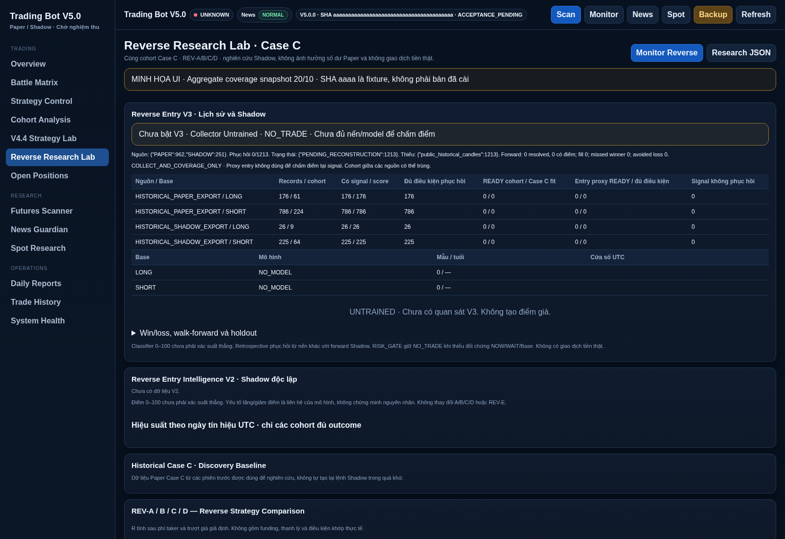

# Trading Bot V5.0 — Issue #20

Tiếp tục từ [PR #19](https://github.com/amen090104-collab/coin-futures-agent/pull/19), pin `b3bf239a0ed36e2276865d3426bf02913e822c9b`. Không dùng V3 preview làm bước cài trung gian. Nhánh V5 riêng, không merge/deploy/publish. Đây là **bản chờ nghiệm thu**, không phải V5 stable/chính thức.

## Cài gói thủ công theo yêu cầu mới

`update.bat` dùng `--from-package`: cài đúng full SHA của gói người dùng chủ động tải, không chờ merge/publish/manifest nghiệm thu và không theo nhánh di động. Vẫn giữ backup/rollback và Paper/Shadow, không tự bật real. Build identity là `LOCAL_PACKAGE_REQUESTED`, không giả thành release đã được duyệt. Các gate public release bên dưới chỉ áp dụng auto-update qua release feed và việc gắn nhãn phát hành chính thức.

## Nâng cấp một lần

Gói `trading-bot-v5-update.zip` có đúng 7 file mã/hướng dẫn và một BUILD_INFO: `update.bat`, `HUONG_DAN_CAP_NHAT_V5.txt`, `.v5-update/{v5_update,v5_package,local_update,local_agent,safe_preupdate_backup}.py`, `.v5-update/BUILD_INFO.json`. Không có `.env`, DB, reports, PAT hoặc lệnh bật Shadow/real. Gói fetch đúng source SHA đã pin qua public Git; không cần token. Phụ thuộc Python vẫn cài qua pip trong venv riêng.

Người dùng dừng V2, giải nén **toàn bộ** gói vào folder Agent cũ, chấp nhận thay `update.bat`, double-click nó, rồi chạy lại bằng tên `run.bat` hoặc `chay_agent_v2.bat` quen thuộc. Không chuyển branch, không pull main và không cài launcher trước. Hướng dẫn chi tiết nằm trong gói. Nếu `update.bat` cũ đã tùy biến, người dùng giữ bản sao trước khi giải nén; sau khi bị ghi đè bởi thao tác giải nén, updater không thể biết nội dung tùy biến cũ.

## Giao dịch cập nhật

1. Kiểm tra checksum gói, Git/Python, exact V2 `534011468670993e656b898d1ed049ebcfab8997` cho lần đầu, working tree, origin, đường dẫn, dung lượng, quyền file và Agent đã dừng. Chỉ thay đổi `update.bat` khớp gói hoặc launcher đã được giao dịch trước tạo ra mới được loại khỏi kiểm tra tracked changes. File cá nhân untracked khác giữ nguyên.
2. Public release phải là `v5.0.0`, PR merged, SHA head/merge của PR và CI Ubuntu/Windows thành công; manifest nghiệm thu phải gắn cùng SHA, Windows user-copy, ≥3 verified market windows, ≥1 READY signal phục hồi và PIT verified. Lần đầu pin gói phải trùng pin release. Không đọc pin V3 local để bỏ qua gate. Không có release hợp lệ trong auto mode: `NO_APPROVED_V5_RELEASE_KEEP_V2`; gói thủ công không cần bước này.
3. Fetch SHA; so sánh helper trong gói với Git blobs; stage source vào `.agent-updater/releases/<SHA>/code`, tạo venv riêng, pip install/check; đối chiếu source với immutable Git archive và lưu `SOURCE_CHECKSUMS.json`. Trước mỗi Run/health, kiểm tra lại checksum source và build identity. Không gắn nhãn V5 chỉ bằng đổi tiêu đề hoặc tin working tree tùy ý.
4. SQLite Backup API gồm WAL, `integrity_check`, `.env`, reports (kể cả REPORTS_DIR), DB bổ sung. Probe schema trên bản sao backup, không chạy jobs. Launcher gốc được lưu kèm checksum trong `backups/updates/<timestamp>/v5-launchers`.
5. Ghi journal PREPARED trước khi thay launcher/pointer. Thay `run.bat`, `chay_agent_v2.bat`, `QUAY_LAI_BAN_CU.bat` bằng dispatcher vào helper đã pin và giữ trong `.agent-updater/v5-runtime/<SHA>`; không phụ thuộc folder gói còn tồn tại. Thay file bằng fsync + atomic replace. Lỗi/AV/power loss có recovery và kiểm tra checksum trước restore.
6. Khởi động ứng dụng V5 thật trong **health-only**: lifespan không init DB/scheduler/recovery/jobs, middleware chỉ cho `/local/health` và `/version`. Xác minh SHA, version, PID/Windows venv redirector và khóa supervisor; dừng probe trước COMMITTED. Không mở browser hoặc để server probe chạy khi update hoàn tất. Người dùng chủ động Run sau đó.

Mỗi lần chạy chỉ có một supervisor/DB owner và một worker bind `127.0.0.1`. Lần hai bị chặn. Không có HTTP API chạy updater. API quản trị thường vẫn cần giữ trong localhost hoặc gateway có xác thực nếu người vận hành tự thay cách triển khai.

Update chưa thành công: phục hồi DB/.env, launcher và pointer trước cập nhật. Journal PREPARED chặn Run cho đến khi Recover. Launcher bị sửa ngoài giao dịch hoặc backup checksum sai: chặn restore, giữ backup để người bảo trì xử lý. Voluntary rollback sau thành công chỉ đổi code, **giữ giao dịch mới phát sinh**, và giữ dispatcher V5 để V2 vẫn dưới supervisor/lock. Không tự chạy lại V2 ngoài quản lý.

Bấm Update lại khi đã ở cùng pin V5 trả `V5_NO_NEWER_APPROVED_RELEASE_CURRENT_VERSION_PRESERVED`, không cài lại/migrate/đổi DB và không báo nhầm “giữ V2”. Lần đầu chưa có V5 được duyệt vẫn trả `NO_APPROVED_V5_RELEASE_KEEP_V2`. Regression kiểm tra cả no-release và same-version.

Windows giới hạn đường dẫn executable, antivirus, disk full hoặc dependency wheels không tương thích có thể chặn stage. Updater không tự tắt antivirus, nâng quyền administrator hoặc di chuyển dữ liệu. Chưa có hash lock wheels đa nền tảng hoặc chữ ký mật mã cho gói; gói cài thủ công do người vận hành chọn được pin và kiểm tra với Git blobs; auto-update dùng reviewed public release. Checksum không thay thế chữ ký khi chính máy/phần mềm phân phối bị kiểm soát.

## UI và trạng thái học

`/version`, `/health` và dashboard dùng chung version `5.0.0`; SHA lấy từ build metadata được kiểm chứng của source staged hoặc Git HEAD khi chạy checkout. Code không xác định SHA báo UNKNOWN, không bịa pin. UI hiện Trading Bot V5.0 + SHA + trạng thái chờ nghiệm thu/đã duyệt; Strategy Battle, Strategy Lab, Reverse Lab vẫn còn.

V3 Historical Learning là tên module nghiên cứu bên trong V5, **không phải bước cài V3**. `Collector Untrained / NO_TRADE` khi chưa có model; score null khác 0. Coverage có records/cohort/signal/score/READY/proxy theo nguồn/Base. Entry proxy tách khỏi training tại signal/holdout/OOS. Mô hình retrospective và genuine forward Shadow không gộp; không bật opt-in Shadow hoặc thay A/B/C/D/REV-E/V2 trong updater. Có ít nhất một READY cũng chưa đủ huấn luyện hoặc kết luận có edge.



Ảnh render bằng Chromium từ HTML thật, fixture UI và aggregate snapshot, không phải bằng chứng đã cài trên máy Windows hoặc hiệu suất model.

## Nghiệm thu dữ liệu thật

`python -m app.v5_acceptance` chỉ đọc DB/reports nguồn đã xác nhận là **bản sao**, ghi output mới ngoài reports nguồn. Nó chạy smoke public BTC/ETH 1h/15m/4h, importer, reconstruct signal/proxy có giới hạn, thống kê coverage và kiểm tra max candle time < signal. Không training, bật flags, gọi orders hoặc sửa nguồn. `private-research.db` giữ riêng; `acceptance.redacted.json` chỉ có counts/provenance public, cần xem trước khi chia sẻ.

```text
python -m app.v5_acceptance --source-db <ban-sao-agent.db> --reports <ban-sao-reports> --confirm-disposable-copy --output-dir <thu-muc-moi> --expected-sha <SHA-40-ky-tu> --reconstruct-limit 10
```

Chỉ `windows_user_copy=true` khi chạy Windows ngoài GitHub Actions, có nguồn copy và cờ xác nhận. Windows CI chỉ smoke public, không mang lịch sử riêng và không được tự gọi user-machine acceptance. Exit 2 khi còn thiếu gate; luôn `not_release_authorization=true`, `model_edge_verified=false`. Người bảo trì phải review bằng chứng và artifact pin trước xuất bản.

Cloud đã thử trên snapshot reports private `84c57a08cef48cbdf45226fe8320f589265ae627`: 962 Paper + 251 Shadow, 285 cohort chung, mọi record có signal/score; READY=0. Smoke **0/3 BLOCKED**, REST 451/archive ProxyError. Dữ liệu nguồn không bị sửa. Chưa có Windows user copy hoặc matched-cohort model đủ dữ liệu để tuyên bố walk-forward/forward OOS hay expectancy V5. Output thật giữ ngoài repo công khai tại `/workspace/issue20-v5-acceptance/cloud`.

Windows GitHub Actions đã gọi public data thật và xác minh **3/3 windows**, [CI ở pin 408189d](https://github.com/amen090104-collab/coin-futures-agent/actions/runs/39619578455). Evidence có UTC/max close/checksums/provider/provenance, không chứa lịch sử private. `windows_user_copy=false`, `private READY=0`: kết quả này xác nhận khả năng đọc nến trên Windows runner, không thay nghiệm thu DB người dùng hoặc bằng chứng học/edge. Sau thay đổi cuối phải chạy lại CI và smoke cho pin mới.

Nguồn chính thức dự phòng đã có: USD-M futures monthly/daily từ `data.binance.vision`, exact symbol/UTC/completed candles, SHA256 chính thức/cache/provenance. Không dùng spot, Bybit/OKX hoặc ticker hiện tại làm dữ liệu Binance gốc. Đã thử đọc tài liệu [Tardis Binance Futures](https://docs.tardis.dev/historical-data-details/binance-futures) và [FAQ/license](https://docs.tardis.dev/faq) để khảo sát nguồn thay thế; cả hai bị ProxyError trong cloud. **Chưa xác minh license/quyền dùng/schema lịch sử**, không tích hợp hoặc dùng API key/phí trả tiền. Nếu Windows cũng bị chặn, cần hợp đồng/quyền dùng và mẫu instrument/UTC/cost tương đương đã được người vận hành duyệt; hiện chưa có nhà cung cấp thay thế đủ bằng chứng để sử dụng.

## Ma trận nghiệm thu và giới hạn

| Yêu cầu Issue #20 | Đã thực hiện | Còn chờ |
|---|---|---|
| Một update.bat từ V2 | ZIP trực tiếp, không bootstrap, launcher cũ được thay có backup | Thao tác thực trên bản sao máy riêng |
| UI/version V5 | API/version SHA, dashboard, Collector Untrained, hai Labs giữ nguyên | Xác nhận GUI trên máy riêng |
| Atomic/data safe | WAL/DB/.env/reports/additional DB, checksum, health-only, journal/recovery, rollback giữ dữ liệu mới | Antivirus/quyền/đường dẫn/wheels thật |
| Nến thật và READY | REST/archive, smoke/coverage CLI, CI Windows public riêng, không giả số | ≥3/3 + ≥1 READY từ Windows user copy |
| Learning | Retrospective/forward/proxy tách, leakage gates V3 giữ nguyên, updater không bật flags | Đủ matched-cohort data và kiểm định OOS |
| Official release | Builder pin full SHA/Git blobs + checksum sidecar; public approval/acceptance gate | Review, user-copy evidence, rồi maintainer publish v5.0.0 |

Baseline PR #19: local **258 passed, 1 skipped**, Windows CI 259 passed. Sau thay đổi V5, local **285 passed, 1 skipped**. E2E clone đúng branch V2, realistic Case balances/closed Reverse/WAL, `.env`/reports/additional DB; Git fetch/archive/venv/pip offline/probe thật; V5 app health-only thật; success/failed health/incompatible schema/AV replacement; voluntary rollback giữ post-update data. Public release/PR/CI feed là fixture, không phải release thật.

Windows chạy CMD `run.bat --check` và **run.bat mặc định**; Linux chạy cùng runtime helper mặc định. Normal Run thực sự khởi động app V5, lifespan/scheduler và `/api/dashboard`, rồi dừng graceful; chỉ network là fixture HTTP 503/DNS không cho ra ngoài, browser bị tắt trong disposable venv test. Không sửa source được đóng gói, không dùng hook này trong sản phẩm. Kiểm tra balance/account events/closed trade và file cũ vẫn nguyên sau normal Run, rollback giữ dữ liệu mới. Đây vẫn chưa phải startup với thị trường/môi trường/DB riêng của người dùng.

Toàn suite, compile và JavaScript chạy trên Ubuntu Python 3.12/Windows Python 3.13.5 cho HEAD cuối của PR. CI Windows build+verify gói từ explicit PR head, chạy thêm public smoke và xuất JSON redacted. Smoke bị chặn là warning/evidence, không đổi thành success dữ liệu; CI unit pass không tự cho phép stable. Xem checks và artifact trên PR kế nhiệm #19.

## Manifest xuất bản — chỉ sau nghiệm thu

Stable release `v5.0.0` dùng JSON body dưới đây. Hiện **không tạo release/tag, không tự merge, không điền giả bằng chứng**. `approved_release.json` cũ vẫn null và không phải gate V5.

```json
{
  "approved_release": {
    "sha": "<SHA-40-ky-tu-da-duyet>",
    "reviewed": true,
    "review_url": "https://github.com/amen090104-collab/coin-futures-agent/pull/<PR>"
  },
  "acceptance": {
    "code_sha": "<cung-SHA>",
    "windows_user_copy": true,
    "verified_market_windows": 3,
    "ready_signal_records": 1,
    "point_in_time_verified": true,
    "review_evidence_url": "https://github.com/amen090104-collab/coin-futures-agent/issues/20#issuecomment-<bang-chung>"
  }
}
```

Số trong template là **điều kiện tối thiểu**, không phải kết quả hiện có. Phải thay bằng số đo thực và bằng chứng đã review; chỉ người bảo trì có quyền publish. Sau commit cuối, chạy lại CI, builder và verify đúng full SHA, phân phối ZIP và SHA256. `update.bat` của ZIP cài đúng SHA người dùng đã chọn qua `--from-package`; auto-update qua release feed vẫn yêu cầu bản đã duyệt.
